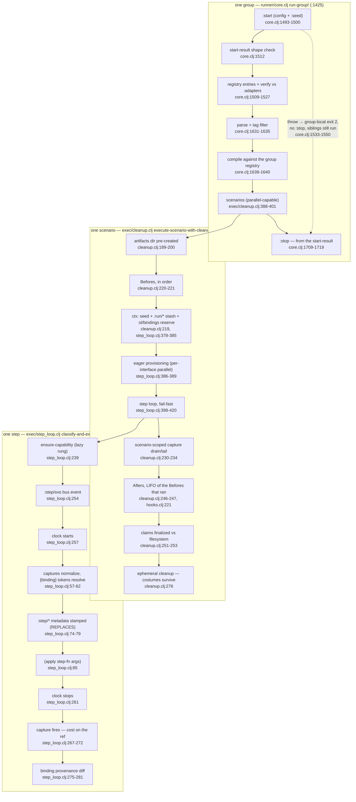

<!-- GENERATED — DO NOT EDIT. Derived from the internal source
     notes/architecture/control-loop.md (development repo) by
     scripts/derive-arch-docs.bb. Edit the source, then re-run:
     bb scripts/derive-arch-docs.bb -->

# The Control Loop — inside one scenario's execution

Extracted and live-verified against the code of the v0.5.5 release line
(2026-08-19; `runner/core.clj` pins re-verified 2026-08-23): the firing
order below is transcribed from the
source order of `runner/core.clj`, `exec/cleanup.clj`, and
`exec/step_loop.clj`, the ctx contract is reconciled verbatim against a
live probe dump, and every failure row marked ✓ was
driven for real at the stamp — exit codes from actual runs, not from the
table they're supposed to match. The [invocation map](invocation-map.md)
owns everything before execute; this map starts where the plan phase's
guarantee ends — "everything knowable without touching the world" is now
known — and shows what happens when the world starts. The doctrine line
this page makes mechanical: never guess before the run, never lie after
it. The first half is the plan phase (the invocation map's territory); the
second half is
this page — every arrow below carries its honest exit, and nothing on
this path can make a result look healthier than it was.

## The weave in one paragraph

Groups run sequentially in declared order and never short-circuit
(`runner/core.clj:1870-1875` — a group that exits 2 does not stop its
siblings; the suite aggregates worst-wins 2 > 4 > 1 > 0 at
`core.clj:1345-1355`). Inside one group: `:start` is invoked with the
config plus the run seed (`core.clj:1493-1500`), its result is
shape-checked, entry-checked, and verified against the group's `:adapters`
declarations (`core.clj:1512-1527`), features parse and compile against
the returned registry (`core.clj:1631-1640`), scenarios execute, and
`:stop` — a key on the start-result, not the group — runs even when they
failed (`core.clj:1709-1719`). Inside one scenario
(`exec/cleanup.clj:152-277`): the artifacts dir is pre-created, Befores
run *before* provisioning (a broken seed hook fails before paying browser
launch), the run stash and data plane are seeded, capabilities provision
eagerly, the step loop runs fail-fast, scenario-scoped captures drain,
Afters unwind in LIFO, attachment claims are finalized against the
filesystem, and ephemeral capabilities are cleaned — costumes stay alive.
Around one step (`exec/step_loop.clj:211-293`): lazy provisioning
no-ops-or-provisions, the `:step/svo` bus event fires, the clock starts,
captures normalize (`{binding}` tokens resolve before the stepdef fn ever
sees them), the `:step/*` metadata is stamped, the fn is applied, the
clock stops, capture fires (cost on the ref, never the step duration),
and binding provenance is diffed. A step can fail; only infrastructure
can degrade.

## The loop



Two facts the diagram earns its place by showing: **Befores run before
any browser exists** (the stash-and-provision nodes sit after them — a
Before failure replaces the whole step-loop call, `cleanup.clj:224`), and
**the step clock excludes both provisioning and capture** — launch cost
lands before `clock starts`, capture cost after `clock stops`, on the
ref's `:attachment/duration-ms` (`step_loop.clj:262-266`).

## The group lifecycle

| # | Fires | Pin |
|---|---|---|
| 1 | `:start` invoked with `(assoc config :seed run-seed)`; a throw is captured, never propagated | core.clj:1493-1500 |
| 2 | start-result shape check (`::setup/start-result` — a map, `:adapter-registry`/`:stop` optional) | core.clj:1512, setup.clj:158-159 |
| 3 | registry **entry-shape** validation — deliberately before step 4, so the legible error wins the race | core.clj:1501-1514 |
| 4 | returned registry verified against the group's `:adapters` declarations | core.clj:1518-1527, setup.clj:299-390 |
| 5 | undeclared-returned-registry deprecation warn | core.clj:1609-1610 |
| 6-7 | parse this group's features; tag filter | core.clj:1631-1635 |
| 8 | compile-suite binds against the group's registry | core.clj:1639-1640 |
| 9 | capture plan-lint | core.clj:1649-1652 |
| 10 | execute (or dry-run preview) | core.clj:1702-1706 |
| 11 | `:stop` — the fn the start-result returned | core.clj:1709-1719 |

Three honesty notes. **`:stop` is not a literal `finally`**: the body
result is captured and `:stop` runs unconditionally after it
(capture-and-rethrow, `core.clj:1625-1628`) — deliberately, because a
`:stop` throw must enrich the returned group result, which a `finally`
cannot do; a crash still resumes to the outer handler (exit 3) after
`:stop` ran. **A `:start` throw means no `:stop` for that group** — the
branch returns before the `:else` that destructures `stop`
(`core.clj:1533-1550`), and mechanically there is nothing to run: `:stop`
rides the start-result that never existed. The group reports a planning
failure (exit 2), its half-started world is the user's to clean, and the
siblings still run — driven live: a two-group suite produced one exit-2
summary and one exit-0 summary in a single invocation. **Dry-run runs
neither `:start` nor `:stop`** (`core.clj:1493` `when-not (:dry-run …)`)
— the plan phase touches nothing, so there is nothing to tear down.

## Around one step

| Order | Action | Pin |
|---|---|---|
| a | skip check: previous step not `:passed` → this one `:skipped`, nothing below fires | step_loop.clj:224-230 |
| b | `ensure-capability` — the lazy rung; no-ops if eager already provisioned | step_loop.clj:239 |
| c | `:step/svo` bus event | step_loop.clj:254 |
| d | clock starts | step_loop.clj:257 |
| e | captures normalize: value-slot quotes stripped, `{binding}` tokens resolved by bind-time `:slot-kinds` — a resolution error is a step `:failed`, fn never called | step_loop.clj:57-62 |
| f | ctx metadata stamped: `:step/arguments` `:step/text` `:step/keyword` (+ `:step/interface` when the step has SVO) — `with-meta` REPLACES | step_loop.clj:74-79 |
| g | `(apply step-fn args)` — ctx-first when arity = captures+1, else captures only | step_loop.clj:50, 81-85 |
| h | return classified: map REPLACES ctx wholesale · nil = unchanged · `:pending` · anything else `:step/invalid-return` → `:failed` | step_loop.clj:86-109 |
| i | clock stops — before capture, so capture cost never pollutes step durations | step_loop.clj:261-266 |
| j | capture fires per policy | step_loop.clj:267-272 |
| k | binding provenance diffed into the step result (`:bindings/produced`) | step_loop.clj:275-281 |

**A step throw is `:failed`, never `:error`** (`step_loop.clj:111-118`):
assertion misses and unexpected exceptions land in the same branch, and
`rollup-status` deliberately has no `:error` arm (`step_loop.clj:178-185`)
— infrastructure failure is not a step outcome. Driven live: a
`RuntimeException` from a step exits 1, not 4. Everything at plan time
stays at plan time: the stepdef fn, arity, captures, slot-kinds, and SVO
were all resolved by the binder (`bind.clj:372-386`); the loop only reads
them, and runtime dispatch is arity-only.

## Every failure's honest exit

Exit meanings are the [invocation map](invocation-map.md)'s verdict table;
this table is who contributes what. ✓ = driven live at the 2026-08-19
stamp.

| Failure | Scenario status | Exit | Pin |
|---|---|---|---|
| step assertion miss / step throws ✓ | step + scenario `:failed` | 1 | step_loop.clj:111-118 |
| step invalid return ✓ | `:failed` (`:step/invalid-return`) | 1 | step_loop.clj:103-109 |
| `{binding}` normalization error | `:failed`, fn never called | 1 | step_loop.clj:59-62 |
| step `:pending` ✓ | `:pending` | 1 strict · 0 under `:allow-pending?` | step_loop.clj:87-90, core.clj:172 |
| Before throws / returns non-map ✓ | `:error`, all steps `:skipped`, no provisioning paid | 4 | hooks.clj:129-141, cleanup.clj:224 |
| provisioning fails (eager or lazy) ✓ | step `:failed`, scenario `:error` — steps never carry `:error` | 4 | step_loop.clj:314-324, provisioning.clj:486-519 |
| After throws ✓ | `:error` even when every step passed — broken cleanup is a lying suite | 4 | hooks.clj:190-207, cleanup.clj:269-271 |
| After claim malformed ✓ | `:error` (`:hook/invalid-return`; the claim map is closed: `{:attachments [...]}` only) | 4 | hooks.clj:197-200, attachments.clj:82-84 |
| capture infrastructure fails (code-read) | green → `:error`, capture-attributed; red keeps its status, the ref records the miss | 4 if green | step_loop.clj:325-327, cleanup.clj:238-240; exec_test coverage |
| attachment file missing (valid claim) | untouched — ref marked `:attachment/error`, one warn each | — | attachments.clj:250-254, cleanup.clj:254-259 |
| capability cleanup fails | untouched — `:cleanup-failures` diagnostics, "never the exit code" | — | cleanup.clj:80-101, core.clj:1171-1187 |
| `:start` throws / bad shape / registry mismatch ✓ | group skipped, no `:stop`, siblings run | 2 (group-local) | core.clj:1533-1595 |
| `:stop` throws ✓ | reported + dirty-teardown marker; next run announces, then clears — exit already earned | unchanged | core.clj:1365-1389, 1625-1629 |
| empty selection (the invocation map's territory) | pre-execution | 2 | core.clj:797-822 |
| anything escaping the group body | — | 3 | core.clj:1707-1717, 1992-2010 |

## The ctx contract

What is in `ctx` when user code runs — the keys **in motion**. The
[data-shape ledger](data-shapes.md) (station 10) owns the same families
at rest; this section is who writes them, when, per stage.

**Write sites, in firing order:**

| # | Writer | Contributes | Pin |
|---|---|---|---|
| 1 | scenario setup | `:seed` — present before any hook runs | cleanup.clj:219 |
| 2 | each Before's map return | merged at root; bare lowerCamel keys mirror into `:sl/bindings` | hooks.clj:148-152 |
| 3 | scenario entry | `:run/interfaces` + `:run/timing` (when configured) stashed; `:sl/bindings` reserved as `{}` always | step_loop.clj:378-385 |
| 4 | provisioning | `:cap/<iface>` or `:cap/<iface>.<subject>` (`{:impl … :mode … [:cleanup-handle …]}`), engine bookkeeping under its own ns | provisioning.clj:275-293 |
| 5 | adapter `:on-provision` | adapter keys (e.g. `:sms/scenario-start-ts`) | provisioning.clj:140-171 |
| 6 | steps | replace ctx wholesale; `bindings/capture!` merges named groups into `:sl/bindings` | step_loop.clj:92-95, bindings.clj:345-365 |

**Per stage** (live-verified — the probe dump below is the evidence):

| | Before hook | step fn | After hook |
|---|---|---|---|
| receives | payload `{:ctx :scenario}` + `:artifacts-dir` `:seed` | ctx first when arity = captures+1 | payload `{:ctx :scenario :result}` + same extras |
| `:seed` | ✔ (the only key, first Before) | ✔ | ✔ |
| `:run/*` stash | ✘ — stashed after Befores | ✔ when configured | ✔ |
| `:sl/bindings` | only what earlier Befores mirrored | ✔ always (≥ `{}`) | ✔ final |
| `:cap/*` | ✘ — Befores precede provisioning | ✔ | ✔ live (but tolerate-and-run: absent caps on the provisioning-failure path) |
| `(meta ctx)` | `nil` | `:step/*`, freshly stamped | whatever the final ctx object retained (see below) |
| return | map **merges**; nil = nothing; else `:hook/invalid-return` | map **replaces**; nil = unchanged; `:pending`; else invalid-return | `nil` or `{:attachments [refs]}` only — full-strict |

**The metadata channel is framework-owned and per-step.**
`(meta ctx)` carries `:step/arguments` (`[]` when the step has none — not
nil, live-verified), `:step/text`, `:step/keyword`, and `:step/interface`
when the step has SVO. It is rebuilt from scratch before every invocation
— `with-meta` at `step_loop.clj:74` **replaces**, so metadata a stepdef
attaches to its returned ctx is gone by the next step. No stage other
than step invocation ever stamps it: Befores see `nil`, and an After sees
only what the final returned ctx object happened to retain (a step that
returns the ctx it was handed passes the last stamp along — observed
live; a step that builds a fresh map hands the After nothing). Read it
via `shiftlefter.step` accessors, not by fishing.

**The probe dump** (scratch project: `:timing` + `:interfaces` configured
but zero SVO steps, so the stashes populate and no adapter factory ever
runs — no browser; one global Before contributing
`{:probeToken "…" :custom/before-key 42}`; a `bindings/capture!` step;
then the dump step):

```clojure
{:probe/stage :before, :payload-keys [:artifacts-dir :ctx :scenario :seed],
 :ctx-keys [:seed], :ctx-meta nil}
{:probe/stage :step,
 :ctx-keys [:probeToken :seed :custom/before-key :run/interfaces :run/timing :sl/bindings],
 :ctx-meta #:step{:arguments [], :text "dump ctx", :keyword "When"},
 :bindings {:probeToken "from-before", :orderId "12345"},
 :run-timing {:deadline-ms 30000, :interval-ms 500}, :seed-present? true}
{:probe/stage :after, :payload-keys [:artifacts-dir :ctx :result :scenario :seed],
 :ctx-keys [:probeToken :seed :custom/before-key :run/interfaces :run/timing :sl/bindings],
 :ctx-meta #:step{:arguments [], :text "dump ctx", :keyword "When"}}
```

Note the mirror rule live: the Before's bare `:probeToken` appears at
root *and* in `:sl/bindings`; its namespaced `:custom/before-key` stays
root-only; the step-captured `:orderId` joins the data plane. There is no
ctx spec, by design — the ledger's stability tiers rule ctx
"reserved-namespace": the key families are the contract, the map stays
open (0.6 fences writes).

## The substrates

**Provisioning — one mechanism, three strategies.**
`ensure-capability-for-svo` (`provisioning.clj:201-298`) serves the
scenario-start eager phase (default, `config [:runner :provisioning]`),
the per-step lazy rung, and the REPL's bare path. Eager launches after
Befores, per-interface parallel but sequential within an interface
(`provisioning.clj:351-368`); lazy launches immediately before the first
step that needs the (interface, subject) — either way the cost lands
outside the step clock. Costumes attach instead of spawning
(`provisioning.clj:109-138`): `:mode :persistent`, no `:cleanup-handle`,
scenario-end cleanup never tears the session down — the two-reapers story
is the [REPL lifetimes map](repl-lifetimes.md)'s.

**Dispatch — settled at plan time.** The `[instance]` annotation names a
config instance whose *type* narrows stepdef candidates
(`bind.clj:309-319`); instance resolution stamps the SVO
(`bind.clj:208-244, 378-380`). At runtime there is no interface dispatch
left — arity decides the calling convention, and the instance rides
`(meta ctx) :step/interface` for the built-ins' capability lookup
(`step.clj:92-100`).

**Timing — a five-rung ladder, resolved lazily in the step body.**
`:override` (dynamic vars) > instance `:timing` > type `:timing` > global
`:timing` > class defaults (`step.clj:121-132`); each of
`:deadline-ms`/`:interval-ms` resolves independently and reports its
source. The engine stashes the rungs (`:run/timing`, `:step/interface`)
and `step/timing`/`step/poll-until` resolve on call. Doctrine enforced by
wrapper placement, not runtime checks: oracles retry, mutations never,
negation doesn't wait (`step.clj:41-55`, `browser.clj:97-100`). User
prose: [extending-vocabulary § Timing](../extending-vocabulary.md).

**Capture — two sites, one matrix (sl-3q9r/sl-sehc).** Per-step site
(`step_loop.clj:267-272`): `:every-step` follows the acting subject, all
kinds; `:on-failure` fires **on `:failed` only** — provisioning failures
have no settled instant to witness, Before failures never reach the loop,
After failures happen after both sites. Scenario site
(`cleanup.clj:230-234`): scenario-scoped kinds drain red-only under
`:on-failure`, tail-sweep always under `:every-step`. Console capture is
a destructive WebDriver drain — each read returns-and-clears
(`etaoin.clj:192-197`). A capture failure on a green scenario flips it
`:error` — green with missing evidence is the disease this framework
exists to make visible (`capture.clj:31-34`); red keeps its status.

**Hooks.** Payloads are single maps (`{:ctx :scenario [:result]}` +
`:artifacts-dir` `:seed`) so keys can be added without breaking every
hook ever written (`exec/hooks.clj:32-34`). Befores merge, outermost
first (globals in registry order, then tag order); Afters unwind
`(reverse frames)` — the throwing Before gets no frame, entries with no
`:before` always unwind, and on provisioning failure all Afters run
*without* capabilities (tolerate-and-run, `exec/hooks.clj:16-30`).
`@hook=` names resolve at plan time; unknown names are exit 2 with
file:line, even with no hooks.clj (`runner/hooks.clj:236-265`,
`core.clj:911-930`).

## Bus events on this path

Exactly four `events/publish!` sites exist in `src/` (grep-verified):

| Event | When | Pin |
|---|---|---|
| `:test-run/started` | once per group (each group is its own run scope) | core.clj:558, 1190-1204 |
| `:step/svo` | after provisioning, before invoke — SVO steps only | step_loop.clj:140-156, 254 |
| `:scenario/finished` | coordinator thread, actual completion order (the reporter plane re-orders to plan order separately) | core.clj:1111-1112, 1043-1084 |
| `:test-run/finished` | end of the group, before the reporter's `:run-end` fan-out | core.clj:1262-1270 |

Negative space, stated: there is no `:scenario/started`, no
`:step/started`, no `:step/finished`. The four reporter-plane moments are
a separate synchronous plane (`core.clj:231-235`).

## Siblings

- [module map](module-map.md) (require-graph truth). The layering
  law this loop obeys — stepengine never reaches up into runner — is its
  territory.
- [the invocation map](invocation-map.md): everything before
  execute; the verdict table this page's exit column speaks.
- [the data-shape ledger](data-shapes.md): these keys at rest —
  producer/spec/consumers/stability per station; its § spine is this
  page's control-flow dual (station 10 is § ctx contract's shape half).
- [REPL custody & lifetimes](repl-lifetimes.md): the state axis —
  who reaps what this loop provisions, and the REPL's deviations from
  this exact path (hand-built ctx, no run stash, free mode never
  provisions).
- [extending-vocabulary](../extending-vocabulary.md): the user-facing
  dual — what this machinery promises a custom step author; this page
  pins what that page teaches.

## How this page stays true

This page is a mechanical projection of a live-maintained internal source,
regenerated — never hand-edited — by the derivation pipeline and
drift-guarded by the test suite: a hand edit here fails a test, and so
does a page that no longer matches its source.
