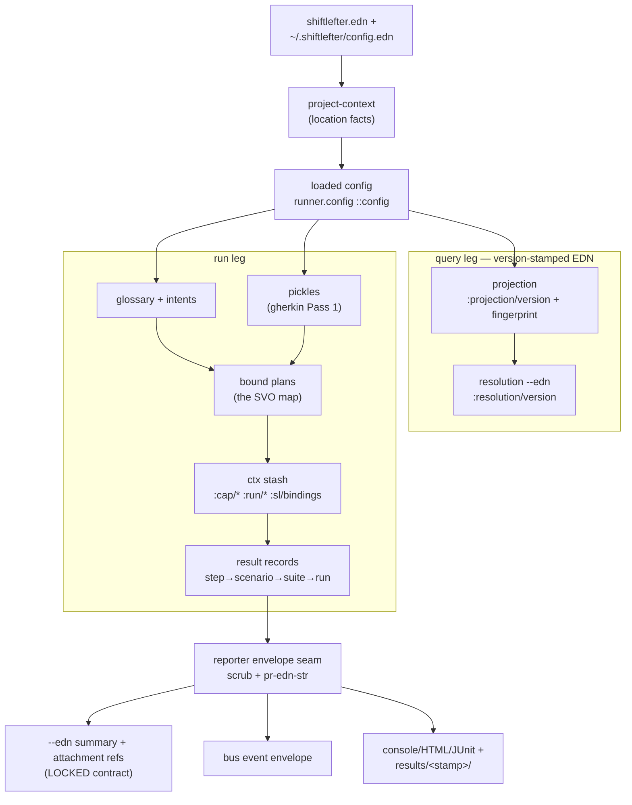

# The Data-Shape Ledger — every boundary-crossing shape, with producer, spec, consumers, stability

Artifact C of the architecture series (siblings: D module map, A
invocation map, E repl-lifetimes). Extracted against **HEAD `39468a25`**
(2026-08-19). This follows the DATA, not the control: where artifact A
walks the verbs, this walks the values. Spec coverage comes from the live
registry, not from memory — all 118 `src/` namespaces loaded into one JVM
yield **675 keyword specs across 58 spec namespaces and 101 fdefs**
(regenerate with § Method), and § Findings reconciles that census against
this ledger. The worked trace uses real captured EDN from a live scenario
run (banked on sl-37xz).

## The chain in one paragraph

Two files enter (the project's `shiftlefter.edn`, the machine's
`~/.shiftlefter/config.edn`); `project-context/resolve` turns cwd + flags
into location facts; `runner.config/load-config` merges and validates the
project config. From there the chain forks and rejoins: the **run leg**
loads glossary + intents, parses features into pickles, binds them into
run plans (where the SVO map is stamped), threads a ctx stash through
execution, and folds step → scenario → suite → run results; the **query
leg** (`orient`/`glossary`/`explain`) rides `build-projection` over the
same loaders and emits version-stamped EDN. Everything the run wants to
say crosses ONE seam — the reporter envelope discipline — and leaves as
the locked `--edn` summary (payload by attachment ref), the bus event
envelope, or a rendered report in `results/<stamp>/`. The stability story
is deliberately tiered: inputs are spec-validated at the boundary,
outputs are contracted by docs + additive discipline (§ Stability tiers).



## The ledger

One station per boundary shape. Producer pins are definition lines at
HEAD `39468a25` (§ 1's config pins re-verified 2026-08-23, sl-d3cz);
"spec" is the registered `s/def` keyword (— means none registered: the
contract is docstring/doc, see § Stability tiers).

### 1. Project config — `shiftlefter.edn`

| Shape | Producer | Spec | Consumers | Stability |
|---|---|---|---|---|
| loaded config map | `runner.config/load-config` config.clj:326 (safe wrapper :400; `normalize` :792; `lint-config` :556) | `::config` config.clj:154 + ~44 sub-specs (`::runner` :98, `::interfaces` :129, `::costumes` :136 + `::costume-def` :135, `::svo` :145, `::glossaries` :151, `::timing` :109, …) | projection (project_projection.clj:94), run pipeline (runner/core.clj:622), doctor, repl, usage-index; all downstream reads go through the accessor surface config.clj:417-511, :831-918 | additive; unknown top-level keys are WARNINGS never errors (forward-compat ruling, config.clj:556-568) |

- Top-level key set:
  `#{:parser :runner :glossaries :interfaces :costumes :svo :timing}`
  (`known-top-level-keys` config.clj:520-528). `:errors` is synthetic,
  added only by `normalize`.
- **Mode invariant (sl-ieie, config.clj:339-343):** the loaded map
  contains `:svo` iff the user's file did. `:svo` presence IS Shifted
  mode — `stepengine/compile.clj:62` and `project_projection.clj:471`
  both key on it.
- **The one computed default (sl-femd, config.clj:307):**
  `:unknown-object` flips to `:warn` iff `[:glossaries :intents]` is
  configured, else `:off` — `apply-conditional-object-default` is the
  single place this is decided (visible live in the trace below).
- Conventional glossary probing (sl-fcjm, config.clj:278) runs only when
  the user config has no `:glossaries` key at all — whole-map semantics.
- Nested maps (`:interfaces` entries, adapter `:config`) are open by
  design; `:webdriver`/`:webdriver-url` deliberately excluded (sl-7kct).

### 2. Machine config — `~/.shiftlefter/config.edn`

| Shape | Producer | Spec | Consumers | Stability |
|---|---|---|---|---|
| user config map | `config.user/load-user-config` user.clj:61 (safe :83; merge :101) | — | costume (costume.clj:239,281,356,474), doctor probes (doctor.clj:151,195,201), etaoin adapter spawn path | key set `#{:chrome-path :chromedriver-path}` lives in the ns docstring; enforced only by doctor's literal allowlist doctor.clj:110 (see F8) |

- `resolve-chromedriver-path` user.clj:130 is the declared single source
  of truth for driver discovery (`:path-driver` opt → `:chromedriver-path`
  → PATH), shared by fresh-spawn and costume paths so they cannot drift.

### 3. Project context

| Shape | Producer | Spec | Consumers | Stability |
|---|---|---|---|---|
| project-context map | `project-context/resolve` project_context.clj:153; resolved once per invocation at core.clj:913, threaded as opts `:project-context` | — | runner.config :248/:348, projection :68-96, runner.core :179-213, results.clj :69/:130, teardown-marker :37, wardrobe :65, usage-index :76, daemon :150, doctor, orient, resolution | doc-contract; ownership rule "location facts only, prints nothing, diagnostics are data" (ns docstring) |

- Key set: `:invocation-root :workspace-root :project-root :config-root
  :config-path :config-source :layout :portable? :diagnostics`
  (project_context.clj:167-199). `:config-source` ∈
  `#{:explicit :discovered :defaults}`; `:layout` ∈
  `#{:sl-directory :root :defaults}`.
- **Cross-process lockstep (sl-v7l6):** `instance-root`
  (project_context.clj:201) MUST match `bin/sl`'s `find_instance_root`
  exactly — the shell wrapper and daemon agree on
  `.shiftlefter/daemon.edn` by parallel implementation, not shared code.
- Discovery is closed to `<candidate>/sl/shiftlefter.edn` (layout C);
  root-level configs are no longer discovered; `-c FILE` is the escape
  hatch.

### 4. Projection

| Shape | Producer | Spec | Consumers | Stability |
|---|---|---|---|---|
| projection map | `project-projection/build-projection` project_projection.clj:490 (assembler `complete-projection` :420; bounded view `project-view` :604) | — | orient (orient.clj:208; `--edn` emits it verbatim), resolution (resolution.clj:943), usage-index (usage_index.clj:57), sieve/contract.clj:78 | `:projection/version` = 1 (project_projection.clj:23), stamped on every branch including errors; fingerprint = content identity |

- Full key set at project_projection.clj:466-488: `:projection/id`
  (fresh UUID) · `:projection/version` · `:built-at` · `:project-context`
  · `:source` (`:working-tree`, closed set :25) · `:status` · `:mode` ·
  `:config` · `:substrate` · `:svo-effective` · `:subjects` `:instances`
  `:interfaces` `:verbs` `:intents` `:stepdefs` `:macros` ·
  `:diagnostics` · `:validation-commands` · `:inputs` · `:fingerprint`.
- **The fingerprint key set is a contract** (project_projection.clj:411-425):
  sha256 over exactly `[:projection/version :project-context :source
  :inputs :config :subjects :instances :interfaces :verbs :intents
  :stepdefs :macros :diagnostics]`. `:substrate` (config-path +
  config-source + git sha/dirty) is DELIBERATELY outside it — "the
  fingerprint is content identity; substrate is the citation" (sl-0gfc).
  Adding a key to that `select-keys` breaks fingerprint stability.
- `:inputs` entries are `{:kind :path :exists? :digest}` per contributing
  file (kinds: `:config :glossary/subjects :glossary/verbs
  :glossary/intents :stepdef :macro`).
- Macro entries carry their own nested `:representation-version` 1
  (project_projection.clj:264).
- Same-path doctrine: the projection resolves through the run's own
  loaders (never a parallel path), so a listing can never disagree with
  the run it predicts — see invocation-map § query family.
- Degraded branches (:485-499, :534-546) emit strictly smaller key sets;
  consumers must tolerate absence.

### 5. Resolution outputs — `sl glossary` / `sl explain` `--edn`

| Shape | Producer | Spec | Consumers | Stability |
|---|---|---|---|---|
| resolution EDN maps | `glossary-edn` resolution.clj:355, `explain-edn` :843, `locator-owners-edn` :857, `vanilla-edn` :80, no-project :105 | — | external tooling/agents (the machine surface) | `:resolution/version` = 1 (resolution.clj:42) on all five shapes; "`--edn` is the stable machine surface; the human format is EXPLICITLY UNSTABLE — do not parse it" (ns docstring) |

- **Structural wording discipline (sl-mpu5 addendum 2):** full-corpus
  entries carry `:unused?`, scoped selections carry
  `:referenced-in-selection?` — distinct keys so a consumer cannot read a
  scoped verdict as deletion license (`marker-keys` resolution.clj:203).
- The projection `:fingerprint` rides `glossary-edn` (:362) but not
  `explain-edn`.
- The `:usage` block is fed by `projection.usage-index/bind-corpus`
  (usage_index.clj:57; relocated from svo/ per module-map F3, sl-52ly),
  which re-enters discover→parse→compile with the
  run's own binder; its flat tuples (:152-172) are the node/edge
  vocabulary the graph era consumes (prepaid graph work, :20-22).

### 6. Glossary

| Shape | Producer | Spec | Consumers | Stability |
|---|---|---|---|---|
| merged glossary map | `svo.glossary/load-all-glossaries` glossary.clj:658 (strict variant :699; defaults :373; merge :393; normalize :493) | `::glossary` glossary.clj:175 + sub-specs `::subject-entry` :116, `::verb-entry` :167, `::frame` :158, `::glossary-error` :181 | binder opts via `compile/build-binding-opts` compile.clj:68; bind.clj :575/:599/:617; svo.validate :150; usage-index :150; projection :286; repl; agent-doc builtins-gen | explicit additive contract: "`::glossary` is `req-un`, so consumers that don't know about [added keys] conform unchanged" (glossary.clj:419-421) |

- Runtime key set is a superset of the spec: `:subjects :verbs` (spec'd)
  plus loader-added `:provenance :sources :instance-index`.
- **Merge is wholesale-per-key** (glossary.clj:48-60): a project entry
  replaces the builtin entry entirely, documented lossy. The
  `:override-defaults` flag was REMOVED (sl-h7c3) — glossaries always
  extend; a file carrying the key draws a load-time warning.
- Frame sub-shape carries the slot vocabulary the binder stamps from:
  `::object-kind` `#{:intent :location :text :key}`, `::arg-kind`
  `#{:value :matcher}`.

### 7. Intents

| Shape | Producer | Spec | Consumers | Stability |
|---|---|---|---|---|
| loaded intents map | `intent.loader/load-all-intents` loader.clj:491 → `{:ok {:lookup :regions :boundaries :intents :intent-files}}` | — (loader specs the AUTHORED EDN only: `::interface-locator` :50, `:intent/location` :64, `::collection` :73, …) | bind.clj:683 (grammar hints), svo.validate :42 (object-slot checks), browser/intent.clj:297, locator-index :46, projection :293 | open-map + optional `:path` are the declared forward-compat guards (sl-4mv8, loader.clj:56-59); loaded-map shape is doc-contract (F7) |
| parsed intent ref | `intent.resolve/parse-intent-ref` resolve.clj:95 | `::parsed-ref` resolve.clj:57 (`::segment` :55, `::path` :56) | resolve-intent-ref :152, static validators :193/:266, resolve-location :299 | spec'd; the O-slot value grammar (`Intent.element[n].child`) |

- Global cache boundary: `intent.state/get-intents` state.clj:41
  (memoized; throws on load error) — REPL convenience; the runner
  resolves config-root explicitly.

### 8. Pickles

| Shape | Producer | Spec | Consumers | Stability |
|---|---|---|---|---|
| pickle | `gherkin.pickler/pickles` pickler.clj:432 (public wrapper `gherkin.api/pickles` api.clj:151) | `::pickle` pickler.clj:117 (`:req` namespaced), `::pickle-step` :93, fdefs :460-475 | runner parse stage (runner/core.clj:126/:137 → `:all-pickles`), compile-suite (compile.clj:150), bind-pickle (bind.clj:420), usage-index :52, compliance harness | spec'd; `:pickle/feature-name` is a documented local extension over cucumber pickles (sl-40to) |

- Req keys: `:pickle/id :pickle/name :pickle/source-file :pickle/location
  :pickle/tags :pickle/steps`; step req keys: `:step/id :step/text
  :step/keyword :step/location :step/origin :step/arguments`.
- **IDs are random per run** (`randomUUID` at pickle time,
  pickler.clj:303/:395) — contrast `stepdef/id` = deterministic
  `"sd-" + sha256(pattern-src)[0:16]` (registry.clj:134), the only
  stable ID in the chain.
- **The pickle is not frozen at pickler exit.** Additive step keys are
  assoc'd downstream, outside `::pickle-step`:
  `:step/declared-interface` (annotations.clj:201),
  `:step/synthetic?` + `:step/macro` (macros.clj:240-261). `:step/text`
  keeps the `[iface]` annotation intact; stripping happens at match time
  (bind.clj:306).

### 9. Bound plans — the SVO map

| Shape | Producer | Spec | Consumers | Stability |
|---|---|---|---|---|
| binding map | `bind/bind-step` bind.clj:246 (match branch :371-393) | `::binding-map` bind.clj:72 (all opt-un — open) | step loop (`invoke-step` step_loop.clj:258), provisioning :308/:339, bindings-lint :57 | spec'd-open; drift findings F2 |
| bound step | same | `::bound-step` bind.clj:84; `::status` :77 `#{:matched :undefined :ambiguous :synthetic}` | exec loop, suite-lint :231, reports | spec'd (+ producer-only keys, F2) |
| run plan | `bind/bind-pickle` bind.clj:407 (literal :429-432) | `::run-plan` bind.clj:98 (`:req` `:plan/id :plan/pickle :plan/steps :plan/runnable?`) | execute-suite (cleanup.clj:348), execute-scenario (step_loop.clj:329), reports (`:plan/pickle` read by console/edn/junit), hooks, schedule | spec'd; `:plan/hooks` rides ADDITIVELY (runner/hooks.clj:236, assoc'd only when non-empty — byte-identity for hook-less suites) |
| suite result | `bind/bind-suite` bind.clj:653 (pipeline :688-692: bind-pickle → stamp-costumes :563 → stamp-slot-kinds :632); outer producer `compile/compile-suite` compile.clj:127 | `::bind-suite-result` bind.clj:128 | run pipeline compile stage, dry-run verdict | spec'd; compile's failure returns are NOT (F4) |
| stepdef SVO metadata (authored) | `registry/register!` (stepdef shape registry.clj:4-16; keyed `[pattern-sig iface-type]` :118) | `::stepdef-svo` registry.clj:76 (`:req-un` subject/verb/frame; `::capture-ref` :63 = `:$N`) | binder, projection `:stepdefs`, bindings-join | spec'd |
| extracted SVO (runtime) | `svo.extract/extract-svo` extract.clj:155 (literal :197-201) | `::svo` extract.clj:44 (`:req-un` subject/verb/object/interface) | validate-svo (validate.clj:405), provisioning (`:svo` read at :308/:339), `:step/svo` event payload (step_loop.clj:139) | spec'd; `:args` dropped in transit (F3) |

- **Two shapes share the nickname "SVO"** — the authored placeholder form
  (`:object :$1`) on stepdef metadata, and the runtime substituted form
  on the binding. The ledger treats them as distinct rows; conflating
  them is the sharpest naming hazard in the chain.
- **Bind-time rewrites of the runtime SVO:** `:interface` is overwritten
  with the resolved execution INSTANCE (bind.clj:376-380) — after
  binding it is an instance name, not the type; `validate-svo` re-derives
  the type via config (validate.clj:442-444). `:wears` is stamped at
  bind time (bind.clj:563-579) so runtime provisioning never needs the
  glossary threaded.
- Validation issues: `::svo-issue` validate.clj:65 with a closed `::type`
  set :48-57 (includes the `:bindings/*` family, sl-yh7/sl-gwru).

### 10. Ctx stash

| Shape | Producer | Spec | Consumers | Stability |
|---|---|---|---|---|
| scenario ctx map | seeded by `execute-scenario`/cleanup wrapper (cleanup.clj:219: `{:seed …}` iff `:run-seed`); mutated by steps + Before hooks | — for the map; `::bindings`/`::binding-name` bindings.clj:57-60 for the `:sl/bindings` plane | step loop (step_loop.clj:211), provisioning :41, hooks (:101/:161), cleanup enumeration :103, capture | reserved-namespace contract: `:cap/*`, `:run/*`, `:sl/*` families ARE the stability guarantee; everything else is open (0.5.x; write-fence is 0.6 contracts work) |

- Reserved families: `:cap/<iface>[.subject]` →
  `{:impl :mode :cleanup-handle}` (ctx.clj:116; NOT EDN-safe — live
  drivers); `:run/interfaces` (:166) and `:run/timing` (:186), stashed
  once per scenario; `:sl/bindings` → flat `{lowerCamel-kw → edn value}`
  (bindings.clj:32), the scenario data plane (sl-yh7): forward-only,
  last-write-wins, dead at scenario end, provenance rides run evidence
  (`:bindings/produced`) never the map.
- **Mutation asymmetry** (exec/hooks.clj:29-33): a step's map return
  REPLACES ctx wholesale (step_loop.clj:93-95); Before-hook returns
  MERGE.
- ctx never crosses the reporter seam — `scenario-envelope` drops
  `:scenario-ctx` by allowlist (reporter.clj:263).
- Step-visible metadata travels on the ctx map's METADATA, not in it:
  `:step/arguments :step/text :step/keyword :step/interface` stamped at
  step_loop.clj:72-79, read via the `shiftlefter.step` accessors
  (step.clj:59-92).

### 11. Result records

| Shape | Producer | Spec | Consumers | Stability |
|---|---|---|---|---|
| invoke result | `invoke-step` step_loop.clj:22/:66 | `::invoke-result` exec.clj:47; `::status` :41 `#{:passed :pending :failed :skipped :error}`; `::error` :44 | step loop | spec'd; error types `:step/invalid-return`, `:step/exception` |
| step result | `make-step-result` provisioning.clj:29 (`:binding` = binding minus `:fn`); enriched step_loop.clj:282-289 with `:duration-ms :bindings/produced :attachments` | `::steps` exec.clj:52 (coll-of map — loose) | scenario rollup, envelopes | wrapper `:status` derived from children (rollup step_loop.clj:187) |
| scenario result | `execute-scenario` step_loop.clj:329 (finalize :295; hook-wrapped cleanup.clj:152; Before-failure hooks.clj:223) | `::scenario-exec-result` exec.clj:64 | suite fold, `scenario-envelope` | full runtime keys: `:status :plan :steps :scenario-ctx :error :hooks :attachments :capability-cleanup :duration-ms`; status flips to `:error` on provisioning/capture-infra/After-hook failure (step_loop.clj:322-327, cleanup.clj:265-267) |
| suite result | `execute-suite` cleanup.clj:348 (literal :404-414) | `::suite-result` exec.clj:84; `::counts` :78 | run stage | **`:error` count absent unless positive** (exec.clj:73-76) — byte-identical-golden discipline |
| run result | `execute!` runner/core.clj:1885 → :1264-1280 | — (component specs: `:shiftlefter.runner.run/status` reporter.clj:131) | CLI exit path, programmatic callers | `{:exit-code :run-id :status :counts :result}` + opt `:dropped-events :results-dir :group-root`; `:result` is the RAW exec result BY DESIGN (core.clj:1282-1285) — envelopes are a projection, programmatic callers keep fidelity |

- The exit-code table is its own locked contract: verdict.clj:37, "locked
  at 0.5.1; reopened STRENGTHEN-ONLY for the 0.5.5 window (sl-7c7i);
  re-locks at first users" — see invocation-map § verdict contract.

### 12. Reporter envelopes — the seam

| Shape | Producer | Spec | Consumers | Stability |
|---|---|---|---|---|
| scenario envelope | `reporter/scenario-envelope` reporter.clj:263 (ALLOWLIST projection) | `::scenario-result` reporter.clj:122 (req only `::status`) | all reporters, HTML island, bus payloads | drops `:scenario-ctx`, `:plan/steps`, `:capability-cleanup` — live objects die here |
| error envelope | `reporter/error-envelope` reporter.clj:241 | — | failures sections | `:value` is `pr-edn-str`'d exactly ONCE here; downstream passes through, never re-encodes (edn.clj:108-117) |
| run-ctx | `run-start-ctx` runner/core.clj:491 (+ `:results-dir`/`:artifacts-root` merged :1191-1195) | `::run-ctx` reporter.clj:117 | reporters `on-run-start`, JUnit properties | "deliberately open maps; keys added by later beads must extend, never break" (reporter.clj:77-81) |
| run summary | runner/core.clj:1266-1276 | `::run-summary` reporter.clj:139 | reporters `on-run-end` | `::dropped-events` pos-int? — the absent-when-zero anomaly-marker convention |

- **Four load-bearing invariants** (reporter.clj:15-71, "do not relax
  without a Tower ruling"): coordinator thread only; plan order on the
  report plane (actual order + `:seq` on the bus); pure EDN-native data —
  `scrub` (:222) kills live drivers/fns/atoms and flattens defrecords,
  `pr-edn-str` (:200) pins printer bindings (sl-3ub4); exit-code
  independence with loud failure.

### 13. The `--edn` run summary + attachment refs — the locked contract

| Shape | Producer | Spec | Consumers | Stability |
|---|---|---|---|---|
| run summary EDN | `report.edn/build-summary` edn.clj:363; printed `prn-summary` :432; reporter `EdnReporter` :453 | — by design | external tooling/agents (stdout) | **LOCKED**: "keys are additive, never repurposed — code written against the record survives releases" (docs/REPORTS.md:34-36); canonical shape doc edn.clj:7-73; form-stream contract :75-93; goldens `test/fixtures/golden/edn-*.txt` |
| attachment ref | `attachments/normalize-ref` :143, `finalize-refs!` :222 | `::ref` attachments.clj:69 (`:req` `:attachment/kind :attachment/path`), `::after-return` :82 (closed, lean-strict) | summary `:attachments` index + inline on `:failures` (deliberate duplication, REPORTS.md:70-84) | payload by reference — "the envelope never holds bulk text"; excerpts capped 4096 |

- Top-level keys: `:run/id :run/seed :run/exit-code :run/status :counts
  :dropped-events :planning :failures :attachments :diagnostics :error`;
  dry-run variant adds `:dry-run :group :filtered-out :hooks`
  (core.clj:962).
- **There is no version key.** Versioning is additive-only key growth
  plus the consumer rules (REPORTS.md:41-54): stdout is a form STREAM;
  skip shapes you don't recognize; gate on exit code, route on the
  record. This is the house pattern for machine OUTPUT surfaces — see
  § Stability tiers and F1.
- The contract stays EDN-native (tagged UUIDs, bare symbols survive
  typed); lowering for JSON consumers is a foreign-worker transcoder's
  job (sl-rdiz), not an envelope constraint (reporter.clj:54-60).
- The summary is NOT a file — nothing like `summary.edn` lands in the
  run directory (REPORTS.md:18-21). Redirect stdout to capture it.

### 14. Bus event envelope

| Shape | Producer | Spec | Consumers | Stability |
|---|---|---|---|---|
| event envelope | `events/make-event` events.clj:242; `:seq` stamped in `publish!` :125 | `::event-envelope` events.clj:65 (`:req-un` type/ts/run-id/payload; `:opt-un` seq; `:opt` `:scenario/id`) | observe plane: graph emission, telemetry, future workers | locked alongside the summary (docs/AGENT.md:196-201); delivery is offer!-based drop-and-count (buffer 1024, `dropped-events` :212); total order guaranteed only WITHIN a scenario (events.clj:14-20) |

- Event types at HEAD: `:test-run/started` `:test-run/finished`
  `:scenario/finished` `:step/svo` (payload
  `{:subject :verb :object :interface :interface-type :step-text
  :location}`, step_loop.clj:147-153).

### 15. Reports + the run-results directory

| Shape | Producer | Spec | Consumers | Stability |
|---|---|---|---|---|
| console report | report/console.clj:535 | n/a | humans (stderr) | EXPLICITLY UNSTABLE — never parse |
| EDN report | report/edn.clj:453 | see station 13 | machines (stdout) | locked |
| HTML report | report/html.clj:229 (island `{:run-ctx :scenarios :diagnostics :summary}` :257-260) | — | humans + the island is machine-readable EDN | dual-write: `<group-root>/report.html` + byte copy to `--html` path |
| JUnit XML | report/junit.clj:426 | — | CI systems | written only to the configured path |
| results dir | `results/ensure-run-dir!` results.clj:119 (`stamp` :54, spec `::stamp` :50) | `::stamp` results.clj:50 | attachments, HTML, humans | `<config-root>/results/<STAMP>/` (`20260712T153042Z`); self-ignoring `.gitignore`; explicit setup.clj groups get `<run-dir>/<group-slug>/`, an implicit single group does NOT; `:defaults` contexts, dry runs, and planning failures create nothing (results.clj:130) |

- Reporter protocol: `Reporter` reporter.clj:367
  (`on-run-start`/`on-scenario-complete`/`on-diagnostics`/`on-run-end`);
  `emit-lifecycle!` (runner/core.clj:554) is the single call site per
  moment — reporters synchronously in plan order, then the same moment to
  the bus. Reporters are never bus subscribers (ARCHITECTURE.md
  § Reporting).

## Stability tiers

The chain's contracts are deliberately tiered — the strength of the
guarantee tracks who consumes the shape:

| Tier | Guarantee | Shapes |
|---|---|---|
| **Locked** | keys additive, never repurposed; doc + goldens are the contract; no version key needed | `--edn` run summary, bus event envelope, attachment refs, exit-code table (strengthen-only until first users) |
| **Version-int** | `*/version` integer stamped on every emission; bump = breaking | projection (`:projection/version` + fingerprint key-set), resolution outputs (`:resolution/version`), macro entries (`:representation-version`) |
| **Spec'd additive** | registered `s/keys` specs, mostly `:opt-un`/open; boundary validation on load | project config, glossary, pickles, bind shapes, exec results, reporter run-ctx/summary |
| **Reserved-namespace** | key FAMILIES are the contract, map stays open | ctx stash (`:cap/*` `:run/*` `:sl/*`; open ctx until the 0.6 write-fence) |
| **Doc-contract** | docstring + literal producer define the shape; no spec, no version | project-context, user config, loaded intents map, compile failure shapes |

The pattern behind the tiers: **inputs are spec-validated at the
boundary** (the Clojure-module convention — no unvalidated external data
reaches core functions), while **machine OUTPUT surfaces are contracted
by docs + additive discipline** (the `--edn` summary is the established
precedent). See F1 for the ruling.

## The worked trace — one scenario, four machine surfaces

All captures REAL, from `examples/04-sms-2fa` at HEAD `39468a25`
(2026-08-19), one scenario ("Alice resets her password using a code sent
to her phone", 8 steps, two interfaces, zero custom steps), run live with
ChromeDriver + the example's fixture server. Raw captures banked on
sl-37xz. Substrate stamps the claim:
`{:config-source :discovered, :git-sha "39468a25", :git-dirty? false}`.

**Station 1-2 (config in).** The project config declares two interfaces
and three `:svo` levels — and deliberately omits `:unknown-object`:

```clojure
{:interfaces {:web {:type :web :adapter :etaoin :config {}}
              :sms {:type :sms :adapter :sms-mock}}
 :svo        {:unknown-subject :error
              :unknown-verb    :warn
              :unknown-interface :error}}
```

**Station 3-4 (context → projection).** `sl orient --edn` emits the
projection verbatim. `:mode :shifted` (the `:svo` key is present —
sl-ieie). The sl-femd conditional default is visible: intents are
configured, so the effective levels gained `:unknown-object :warn`:

```clojure
:svo-effective {:unknown-subject :error, :unknown-verb :warn,
                :unknown-interface :error, :unknown-object :warn}
:projection/id "proj-87a5c62e-341b-4045-8447-26809c0500b8"
:projection/version 1
:fingerprint "cdbc7c77844aa95b17c645a4be4e81761886db918764845b6574707b9a3effdc"
```

Each contributing file rides `:inputs` with a digest — content identity,
not just a path:

```clojure
{:kind :config,
 :path ".../examples/04-sms-2fa/sl/shiftlefter.edn",
 :exists? true,
 :digest "d9bbd9a37a13223e5c08719eeec5c51e8db08882d7cfd4af2c2d6bf26d4b546d"}
```

The adapter registry surfaces as `:adapter-metadata` per interface, with
PROVENANCE (sl-hyey): an interface on an undeclared builtin adapter shows
the default entry's full fields (`:provenance :builtin-default`,
`:impl-key`, `:provides`, `:capture-kinds`, `:has-on-provision?`). An
adapter that setup.clj declares shows `:provenance :declared` with the
declaration's data. Example 04's `:sms-mock` pins its runtime fields as
pure data (`:impl-key nil`, `:on-provision? true` — sl-xjx0's W20
grammar), so its entry carries them outright and the registry contract
verifies the live entry against the pin at station 10:

```clojure
{:known? true, :provenance :declared,
 :provides [:shiftlefter.sms.protocol/ISMS
            :shiftlefter.sms.protocol/ISMSInbound],
 :capture-kinds [], :impl-key nil, :has-on-provision? true}
```

A declaration that does NOT pin them instead gets
`:runtime-unknown [:impl-key :has-on-provision?]`: those are facts of the
registry `:start` returns at station 10, not of the plan-time
declaration, so the projection names them unknown rather than guessing
from the default entry — a `:start` may legitimately return an override
without the default's hook or with a different impl shape, and a guessed
`:has-on-provision? true` would then be a lie.

**Station 5 (resolution).** `sl glossary --edn` (`:resolution/version 1`)
shows the corpus-riding usage markers — full-corpus scope, so the key is
`:unused?`, never `:referenced-in-selection?`:

```clojure
{:type :user, :description "Standard application user",
 :instances [:alice], :singleton? false,
 :provenance :user-file, :unused? false, :use-count 8}
```

**Stations 6-9 (glossary/intents → pickles → bound plan).**
`sl run --dry-run --edn` stops at compile — a plan verdict, not a run
verdict (`:run/status :dry-run`, exit 0 = the selection binds). The
setup.clj group names itself, and the SVO validation tier already speaks:

```clojure
{:run/id "83064bcd-…", :run/seed 1187363736201345408,
 :run/exit-code 0, :run/status :dry-run,
 :counts {:scenarios 1, :steps 8}, :group "sms-2fa",
 :diagnostics {:svo-issues [… 2 issues …], :counts {:svo-issue-count 2}}}
```

**Stations 10-13 (execution → envelope).** The live run. In flight, the
`(?<code>\d{6})` named group on the SMS receive step binds `code` into
`:sl/bindings`; two steps later `{code}` resolves it back into the fill —
the scenario data plane doing its one job. The captured summary
(stdout; stderr carried only the `run seed:` line):

```clojure
{:run/id "3de3400c-b959-430c-93cf-9c5663a3f930",
 :run/exit-code 0, :run/status :passed,
 :run/seed 5788014003369720924,
 :counts {:passed 1, :failed 0, :pending 0, :skipped 0,
          :scenarios 1, :steps 8},
 :diagnostics
 {:svo-issues
  [{:type :svo/unknown-object, :object "Enter Verification Code",
    :message "Invalid intent reference: …",
    :location {:step-text ":user/alice should see 'Enter Verification Code'",
               :step-id #uuid "5b43275a-…", :uri ".../password_reset_sms.feature",
               :line 11, :column 5},
    :severity :warn}
   {:type :svo/unknown-object, :object "Code verified for alice", …}],
  :counts {:svo-issue-count 2}}}
```

Every ledger claim is visible in miniature: the locked summary's key
vocabulary; counts with `:error` absent (zero); `#uuid` tagged literals
surviving typed (EDN-native stance); the `::svo-issue` shape with its
closed `:type` and full `:location`; and the two `:warn` diagnostics are
the sl-femd default from station 1 firing on the two free-text
assertions — config decision in, diagnostic severity out, one chain.

**Station 15 (disk).** The run created
`sl/results/20260819T144724Z/sms-2fa/` — stamp from the group's
`:started-at`, slug subdir because setup.clj declares an explicit group.
No `summary.edn` — the record went to stdout.

## Findings

Census reconciliation + drift found while pinning the ledger. Bar and
disposition style per artifact D. Ruled at plan fisk (Chair-ratified
08-19): F1 documented as design; F5 dedupes into sl-v8cu; F2/F3/F4/F6/
F7/F8 filed as ONE unscheduled hygiene bead at close.

**F1 — the query leg is spec-less, and that is the design.**
`project-context`, `project-projection`, `resolution`, `usage-index`,
`config.user`: zero registered specs; version ints + docstrings + literal
producers carry the contract. Ruling: consistent with the house pattern —
the boundary-validation convention governs INPUTS (and there the specs
are: config 45, gherkin ~140, bind 32); machine OUTPUT surfaces are
contracted by docs + additive discipline, exactly as the locked `--edn`
summary (station 13) already is. Documented here as design; no bead.

**F2 — bind.clj spec-vs-producer drift cluster.** `::slot-kinds`
(bind.clj:69) omits `:key` though `frame-slot-kinds` (:610) emits it;
`::bound-step` (:84) omits producer-emitted `:filter-info` (:326-347) and
`:instance-resolution` (:392); `::diagnostics`/`::diagnostics-counts`
(:113-120) omit `:ambiguous-instance(-count)` (:673, :708). Open specs
mean nothing breaks — but the spec no longer describes the shape.
→ hygiene bead.

**F3 — `extract-svo` silently drops `:args`.** `::stepdef-svo` declares
an `::args` map (registry.clj:74); the runtime whitelist
(extract.clj:197-201) never carries it, and `substitute-placeholders`
never descends into it. Arg values reach the engine only positionally via
`:slot-kinds`. Either `:args` is dead metadata or the drop is a latent
bug — dispositioned to the hygiene bead for a ruling.

**F4 — compile-suite's failure shapes are unspec'd.** Six hand-built
failure returns (compile.clj:166-276, + `:config-lints` from
runner/core.clj:895) diverge structurally from `::bind-suite-result`.
→ hygiene bead.

**F5 — `:project-context/ambiguous-config` is consumed but never
produced** (runner/config.clj:360 branches on it; no producer in
project_context.clj). DEDUPES into sl-v8cu (same finding, already
filed) — evidence folded in as a comment there, not double-filed.

**F6 — duplicated resolvers have already diverged.**
`resolve-config-declared-paths` exists in runner/core.clj:192 AND
project_projection.clj:81 — the runner copy additionally resolves the
`:report` junit/html paths; same pattern for `resolve-glossary-config`
(runner/core.clj:175 vs project_projection.clj:64). The same-path
doctrine is honored by construction elsewhere; this pair is the residue.
→ hygiene bead.

**F7 — the loaded intents map is unspec'd at the actual boundary.**
loader.clj specs the AUTHORED EDN file schema; the `{:lookup :regions
:boundaries :intents :intent-files}` map that actually crosses into
bind/validate has no spec. Sits on the F1 line but is an internal
INPUT to the binder, not an output surface. → hygiene bead (ruling
whether it graduates to a spec).

**F8 — user-config vocabulary lives in two places.** The key set is
prose in config/user.clj's docstring and a literal allowlist in
doctor.clj:110; adding a key means editing both, with no guard.
→ hygiene bead.

**F9 — registry census: every spec family accounted for.** 675 keyword
specs / 58 namespaces. 23 families map to ledger stations (above). The
remaining families, dispositioned by name — none silently absorbed:

| Family (spec count) | Disposition |
|---|---|
| `sieve.contract` (59), sieve stores | out-of-chain: SIEVE dev-tool era, own `:schema/version` discipline (contract.clj:94-107) — its ledger belongs to the 0.7 arc |
| `sms.protocol` (37+3), `adapters.registry` (15+2) | adapter-seam contracts: the ISMS/ISMSInbound protocol shapes and the adapter registry entry — consumed via station 4 `:adapter-metadata` and station 10 provisioning; a full adapter-contract ledger is its own artifact if the seam opens to third parties |
| `gherkin.parser` (39), `tokens` (8), `lexer` (7), `dialect` (11), `printer` (10), `io` (8), `location` (3), `diagnostics` (7), `api` (18) | Pass-1 internals behind the pickle boundary (station 8); the roundtrip invariant, not the ledger, is their contract |
| `gherkin.compliance` (21), `ddmin` (18), `verify` (12) | framework-dev tools (invocation-map F1 lanes) |
| `runner.core` (12), `discover` (8), `step-loader` (11), `tag-disposition` (11), `setup` (21+2), `hooks` (8), `schedule` (2), `teardown-marker` (6), `suite-lint` (4), `hints` (5), `annotations` (2), `hook-ref` (2) | run-pipeline internals: shapes that live and die inside `execute!`'s stages |
| `doctor` (17+1), `daemon` (14), `costume` (2), `costume.wardrobe` (4) | other-verb surfaces: doctor probes, daemon wire records, costume state — artifact A (lanes) and E (custody) hold their stories |
| `browser.target` (9), `browser.url-match` (13), `step` (6), `attachments` (5), `exec.capture` (8), `graph` (3), `counts` (1), `runner.run` (1), `runner.results` (3), `runner.reporter` (21), `events` (6, at `shiftlefter.events` since sl-52ly), `stepengine.*` (bind 32, exec 19, registry 11, bindings 2), `svo.*` (glossary 26, extract 13, validate 11), `intent.*` (resolve 5, loader 3) | mapped to stations above (browser.target/url-match are step-impl internals under station 10's capability seam) |

## Method

- **Registry census** (the mechanical teeth) — load every src namespace
  into one JVM and dump the registry; kaocha owns `:main-opts` in
  `:test`, so use bare `clojure.main`:

  ```bash
  NSES=$(find src/shiftlefter -name '*.clj' \
    | sed 's|^src/||; s|\.clj$||; s|/|.|g; s|_|-|g' | tr '\n' ' ')
  java -cp $(clojure -Spath -A:test) clojure.main -e "
  (require '[clojure.spec.alpha :as s])
  (doseq [n '($NSES)]
    (try (require n) (catch Throwable e (println \"FAILED\" n))))
  (let [ks (->> (s/registry) keys
                (filter #(re-find #\"shiftlefter\" (str (namespace %)))))]
    (println :keyword-specs (count (filter keyword? ks)))
    (println :fdefs (count (filter symbol? ks)))
    (doseq [k (sort-by str ks)] (println k)))"
  ```

  At HEAD `39468a25`: 0 failed requires, 675 keyword specs, 101 fdefs.
  Per-namespace aggregate: pipe the keyword lines through
  `sed 's|^:||; s|/.*||' | sort | uniq -c | sort -rn`.
- **Producer/consumer columns**: spot-verified by reading the pinned
  definition lines and grepping callers (`grep -rn '<fn-name>' src/`);
  the three load-bearing shapes (config, run plan, summary envelope)
  were re-verified by hand at HEAD.
- **Worked trace**: from `examples/04-sms-2fa/` —
  `clj -M:demo --edn > run.edn` (live; needs ChromeDriver),
  `clj -M:demo --dry-run --edn`, and
  `clj -M -m shiftlefter.core orient --edn` / `… glossary --edn`.
  Captures banked on sl-37xz.
- **Re-stamp**: rerun the census and the four captures, update the HEAD
  sha in the header, diff the census against § Findings F9 — a NEW spec
  namespace must either join a station or take a disposition row.

## Siblings

- A — [invocation map](invocation-map.md): the verbs these shapes travel
  under; its § spine is this ledger's control-flow dual.
- D — [module map](module-map.md) (require-graph truth).
- E — [REPL custody & lifetimes](repl-lifetimes.md): what outlives the
  invocation; this ledger's ctx/capability rows at rest.
- B — [the control loop](control-loop.md): these shapes in motion — the
  firing order that produces them, and the ctx contract per stage
  (station 10's time-axis half).
- ARCHITECTURE.md § Data shapes at boundaries holds the one-screen folk
  table; this ledger is the detailed authority behind it.
