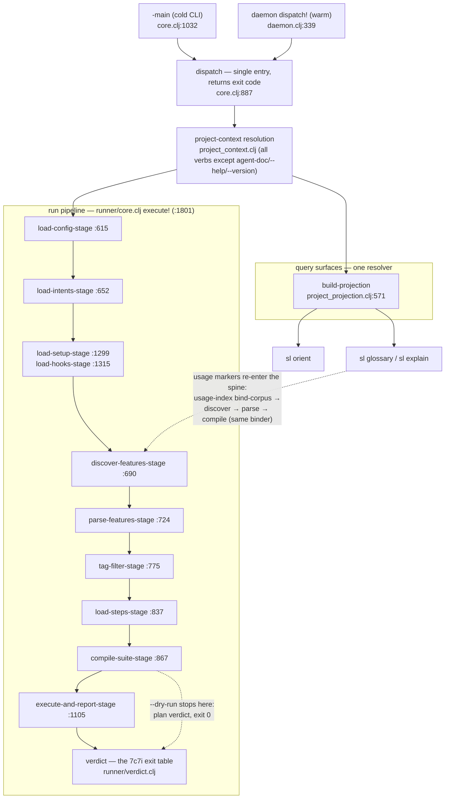

# The Invocation Map — every `sl` verb through the shared spine

Artifact A of the architecture series (sibling of the module map, artifact
D). Extracted and live-verified against **HEAD `0b77c34e`** (2026-08-18);
line pins re-verified and the `init` lane added 2026-08-23 (sl-d3cz);
every exit code below was transcribed from an actual run (jar rebuilt at
the 08-18 HEAD, before the 0.5.5 version bump).
Verb completeness comes from the dispatch table itself, not from memory —
see § Method.

## The shape in one paragraph

There is **one command entry point**: `dispatch` (`src/shiftlefter/core.clj:887`)
returns an exit code and never calls `System/exit`, so the cold CLI
(`-main`, `core.clj:1032`) and the warm daemon (`daemon.clj:339
dispatch!`) run the *same* branches — warm/cold parity is structural, not
tested-in. Verbs then split into three families: the **run family**
walks the runner pipeline's stages and speaks the verdict contract; the
**query family** (`orient`, `glossary`, `explain`) rides
`build-projection` (`project_projection.clj:571`) — the run's own
config/glossary/intent/stepdef loaders behind one resolver, so a listing
can never disagree with the run it predicts — and since resolution
queries v2, `glossary`/`explain` additionally re-enter
discover→parse→compile through `projection/usage_index.clj` to bind the corpus
for usage facts (same binder, never a parallel path); the **utility
family** (`fmt`, `doctor`, `costume`, `daemon`, `agent-doc`,
`gherkin`, `verify`) needs at most the project context.

## The spine

Two facts the diagram earns its place by showing: **the planning verbs
stop at compile** (dry-run's exit 0 is a plan verdict — the selection
binds — not a run verdict), and **the query surfaces hang off the same
resolver the run uses**, with the v2 usage loop drawn as a re-entry into
the run's own discovery/parse/bind stages rather than a second reader.

## Lanes

Every branch of the dispatch `cond` (`core.clj:917-1030`), one row each.
"Enters at" is the branch's command fn; codes marked ✓ were produced by a
live run (see § Method for the battery).

| Verb | Enters at | Stops at | Emits | Exit codes (live-verified ✓) |
|---|---|---|---|---|
| `run` | `run-cmd` core.clj:132 → `execute!` runner/core.clj:1891 | full pipeline → verdict | console report; `--edn` summary; `--junit-xml`; `--html`; captures | 0 pass ✓ · 1 fail ✓ · 2 planning/bad path ✓ · 3 crash · 4 degraded (7c7i table) |
| `run --dry-run` | same | after compile-suite + capture-plan lint (runner/core.clj:2063) | bound-plan line (stderr), hook preview; `--edn` plan summary | 0 binds ✓ · 2 binding/discovery errors ✓ |
| `fmt` (`--check/--write/--canonical`) | `fmt-cmd` core.clj:433 | parser round-trip only — no pickles, no binding | per-file OK/NOT-OK lines; formatted text | 0 clean ✓ · 1 check-failure ✓ · 2 usage. NOTE: fmt's 1 is "file not canonical", not the verdict table's "scenario failed" — fmt is not a run surface |
| `gherkin fuzz` | `fuzz-cmd` core.clj:539 | parser property loop (no project context use) | trial summary; failure artifacts under `--save` | 0 all pass ✓ · 1 failures. Framework-dev tool |
| `gherkin ddmin` | `ddmin-cmd` core.clj:597 | parser shrink loop | minimized `<file>.min` | 0 wrote minimal ✓ · 2 no path. Framework-dev tool |
| `verify` | `verify-cmd` core.clj:673 | validator battery (framework repo only) | check report | 0 · 1 failures · 2 outside framework repo ✓ |
| `agent-doc` | `agent_doc.clj:98` | resource print (no project context — the one context-free verb, core.clj:912) | packaged doctrine topic | 0 ✓ |
| `orient` | `orient.clj:178` | projection (no corpus bind) | orientation card; `--edn` full projection | 0 ✓ · 1 projection load failure · 2 ambiguous config |
| `glossary` | `resolution.clj:531` | projection + corpus bind (usage markers; `duplicates` section skips the corpus) | listing with provenance + usage markers; `--edn` | 0 listed/honest-vanilla/no-project ✓ · 1 load failure · 2 bad section/ambiguous config |
| `explain` | `resolution.clj:943` | projection + corpus bind; `{…}` arg → locator reverse index only | per-kind resolution + usage; owners for a locator | 0 found ✓ · 1 miss ✓ · 2 malformed ✓ |
| `costume init` | core.clj:719 | wardrobe + real Chrome launch | profile dir + live browser for one-time login | 0 · 1 launch failure · 2 usage (code-read; not live-run — launches a real browser) |
| `costume relaunch` | core.clj:733 | wardrobe + Chrome relaunch | relaunched browser on the costume profile | as init (code-read) |
| `costume list` | core.clj:751 | wardrobe read | costume table + liveness | 0 ✓ |
| `costume destroy` | core.clj:772 | wardrobe delete (refuses while live unless `--force`) | removal confirmation | 0 · 1 refused/failed · 2 usage (code-read) |
| `doctor` | `doctor.clj:629` | probe registry (machine pre-flight; no feature corpus) | probe table; `--list`; `--edn` | 0 all ok · 1 issues found ✓ |
| `init` | `init/init-cmd` init.clj:161 (branch core.clj:1010) | scaffold write: `sl/` config + glossary + starter feature + AGENTS.md stanza (marker-guarded); bails touch-nothing if `sl/shiftlefter.edn` exists | one line per artifact; breadcrumb commands | 0 scaffolded AND 0 bailed (code-read; deliberately absent from `--help` until system-wide distribution, sl-f1ir) |
| `daemon serve` | `daemon-cmd` core.clj:810 | long-lived JVM serving `dispatch` over the wire (auto-spawned by `bin/sl`) | socket + port file | blocks; lifecycle codes on the client side |
| `daemon status` | core.clj:810 | registry read | daemon record (port/pid/jar) | 0 ✓ |
| `daemon stop` | core.clj:810 | signal + reap | stopped confirmation | 0 ✓ |
| `repl` | dispatch returns the `:repl` sentinel (core.clj:1017) — `-main` starts the REPL | blocks; no exit code by design (`dispatch` docstring) | interactive session / nREPL | n/a |
| `--version` | core.clj:962 | immediate | version string | 0 ✓ |
| `--help` | core.clj:929 | immediate | usage text | 0 |
| *(parse error)* | core.clj:922 | immediate | errors on stderr | 2 — a typo'd flag never executed anything |
| *(unknown command)* | core.clj:1019 | immediate | hint on stderr, stdout clean | 2 ✓ |

## Exit codes: the verdict contract (sl-7c7i)

The run family's column is one table, owned by `runner/verdict.clj` and
guard-tested against the docs (`exit-contract-guard-test`):

| Code | Status | Meaning |
|---|---|---|
| 0 | `:passed` | existential pass — ≥1 scenario selected, none failed/errored |
| 1 | `:failed` | ≥1 scenario failed (valid tests, app wrong) |
| 2 | `:planning-failed` | invalid before execution — nothing ran (config/parse/discovery/binding, un-runnable invocation, empty selection) |
| 3 | `:crashed` | runner crash; wins over everything (cold and warm paths both map Throwable → 3) |
| 4 | `:degraded` | ≥1 scenario `:error` — infrastructure failure; verdict about the app unavailable |

Precedence: 3 anywhere; 2 pre-execution exclusive; execution worst-wins
4 > 1 > 0. Non-run verbs reuse 0/1/2 with verb-local meanings (noted per
lane above); none of them can produce 3/4 short of a crash.

## Findings

**F1 — the bead's verb list undercounted by six.** The dispatch table
carries `gherkin fuzz`, `gherkin ddmin`, `verify`, `agent-doc`, `repl`,
and `daemon status`/`stop` beyond the verbs the bead named. All are lanes
above. Disposition: the dispatch `cond` is the completeness authority;
this map's § Method regenerates the inventory mechanically.

**F2 — there is no `sl costume connect`, by design.** The bead text named
a `connect` CLI verb; the code has `init`/`relaunch`/`list`/`destroy`
only. Ruled at plan fisk (Chair-ratified 08-18): a one-shot CLI process
cannot hold a WebDriver session, so *attach* exists only in the surfaces
that persist — the REPL's `connect-costume!` and the runner's wear
provisioning. Disposition: bead-text error, documented here as the design
fact.

**F3 — setup/hooks load earlier than the folk sketch says.** The naive
spine (and the bead's own stage list) places setup/hook loading after
binding; the code loads them immediately after intents
(`runner/core.clj:1999-2003`), *before* discovery, so hook applicability
and setup groups exist when compile-suite attaches them. The bead's stage
list also inserted "projection" into the run spine — the projection is
the query surfaces' substrate, not a run stage. Disposition: diagram
drawn from the code; sketch corrected here.

## Method

- Verb inventory: `grep -n '(= (first arguments)' src/shiftlefter/core.clj`
  plus the flag/error branches of the same `cond` — every hit is a lane row.
- Exit codes: each ✓ is `"$@" > out 2>&1; echo $?` from the 08-18 battery —
  planning verbs against `examples/01-validate-and-format` and
  `examples/03-custom-steps` via the freshly built jar (`bin/sl`),
  Shifted-mode query verbs against `examples/04-sms-2fa`, the failing-run
  lane against a scratch project with one deliberately failing scenario,
  `verify` from a non-repo directory. Costume mutation verbs are
  code-read (they launch a real browser); `daemon serve` was exercised
  implicitly — the battery itself ran warm through the auto-spawned daemon.
- Cross-checks: exit column vs `runner/verdict.clj` (quoted above) and
  `test/shiftlefter/exit_contract_guard_test.clj`.
- Re-stamp: rerun the battery and update the HEAD sha in the header after
  any dispatch or stage change.

## Siblings

- D — [module map](module-map.md) (require-graph truth)
- E — [REPL custody & lifetimes](repl-lifetimes.md): where the `repl`
  lane's `:repl` sentinel hands off — the one surface where things
  outlive the invocation.
- C — [the data-shape ledger](data-shapes.md): the values these verbs
  carry — every boundary-crossing shape with producer/spec/consumers/
  stability; its chain diagram is this map's data-flow dual.
- B — [the control loop](control-loop.md): where `execute-and-report-stage`
  hands off — inside one scenario's execution, the ctx contract, and every
  failure path's honest exit.
