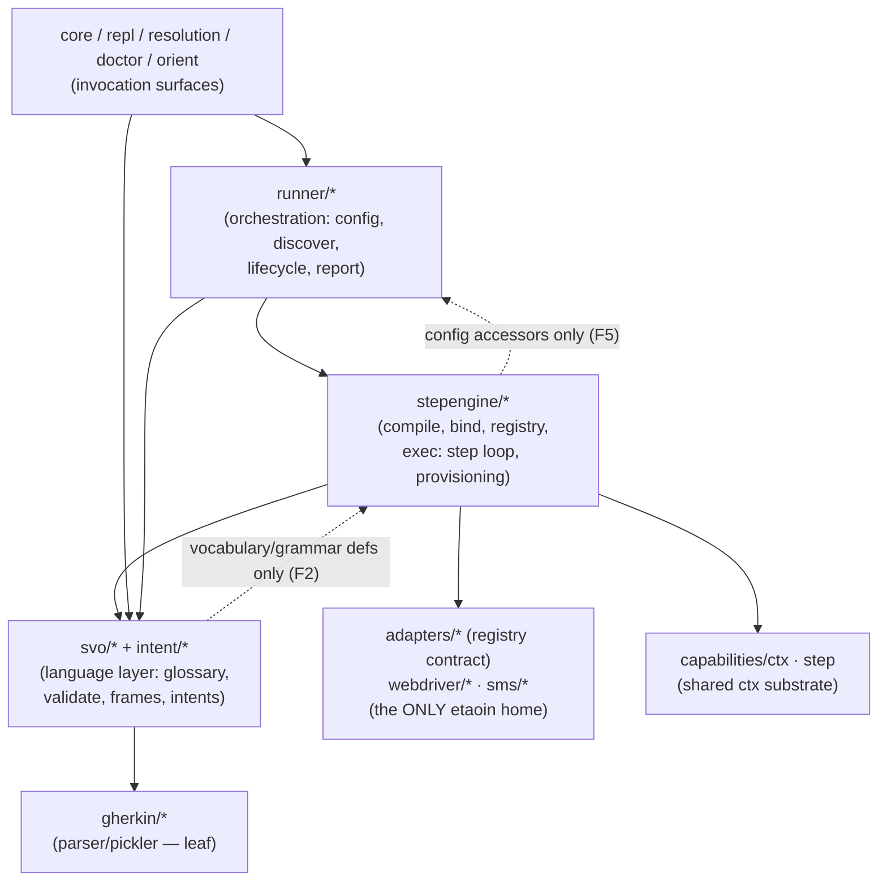

# Module Map — checked against the actual require graph (2026-08-18; re-extracted 2026-08-23, re-verified at the site sync 2026-08-23 evening)

Artifact D of the architecture-artifact series (D → A → B ruled 08-18;
C follows). Tower-authored; arrows below are EXTRACTED from `(:require …)`
forms across `src/shiftlefter/**/*.clj` (517 edges at the 08-23 evening
site-sync re-verification, sl-xzom — the one edge over the sl-d3cz
re-extraction's 516 is `daemon → costume`, sl-s35y's `sl daemon status`
custody listing, an intra-cluster edge among the invocation surfaces that
changes no cluster arrow below; was 494 pre-relocations on 08-18), not
drawn from memory. Raw edge list: regenerate with the one-liner in
§ Method.

## The intended shape (the laws as practiced)



Laws checked: (1) etaoin contained to the webdriver layer; (2) svo never
reaches up into stepengine/runner — EXCEPT engine-owned
vocabulary/grammar definitions (F2 restatement); (3) gherkin is a leaf;
(4) stepengine never reaches up into runner — EXCEPT runner-owned CONFIG
ACCESSORS, pure data readers over the config map it already receives,
never orchestration, lifecycle, or report machinery (F5 restatement,
Chair-ratified 08-23).

## Verdict

**Sane.** No dependency cycles (the Clojure loader would refuse them), the
hub shape is as intended (invocation surfaces fan into runner; runner
orchestrates the engine; the engine consumes the language layer), gherkin
is a clean leaf (law 3 passes with zero violations). Four findings, all
ADDRESS-level (things living at the wrong namespace address), none
behavioral.

## Findings

**F1 — etaoin containment: 6 importers, law says ~2.**
`webdriver/etaoin/{browser,session}` are the home (correct);
`adapters/etaoin.clj` is legitimately the etaoin adapter entry (the
registry factory + capture fns — the law's real boundary is "etaoin API
stays behind the adapter/webdriver seam," which this honors);
`sieve/{server,web}` are dev-tool heritage (exempt-but-note). The real
find: **`svo/keys.clj` requires `etaoin.keys`** — it is the W3C
key-name → etaoin-constant table (sl-rch). The language layer holding
vendor constants is the one true containment break. Fix: table moves to
`webdriver/etaoin/keys.clj`; svo keeps only the pure W3C name list.
**DISPOSITION (sl-52ly, sitting-ruled + executed 08-19): SPLIT.**
svo/keys keeps the closed W3C name set; `webdriver/etaoin/keys.clj` owns
name→unicode (the only real table); `webdriver/playwright/keys.clj`
collapsed to identity-except-Space — the etaoin-unicode middleman (and
its double translation) deleted. The parity test
(`test/shiftlefter/webdriver/keys_parity_test.clj`) pins the vendor
tables to the name set and is the extension mechanism.

**F2 — svo ↔ stepengine is bidirectional.** `stepengine → svo` (5 edges
at extraction; 6 since sl-1206 added `stepengine/costume_lint →
svo.validate` — the shared did-you-mean helper) but also
`svo/{validate,bindings_lint,bindings_join} →
stepengine.bindings` (the stepdef-binding data). Either
`stepengine.bindings` is actually shared substrate that belongs BELOW both
(move/rename down, breaking the back-arrow), or the law needs restating.
No cycle exists at the namespace level, but the pair reads as one layer
wearing two prefixes.
**DISPOSITION (sl-52ly, sitting-ruled 08-19): DOCUMENT-AS-INTENTIONAL —
the law restated:** svo may consume engine-owned vocabulary/grammar
definitions, never compile/exec/registry machinery. The back-arrow is
the shared-classifier doctrine (plan-time validation and exec-time
resolution read ONE grammar definition); recorded at the
`stepengine/bindings` ns docstring. Correction at HEAD: the back-arrow
is two namespaces (`svo/{validate,bindings_lint}`) — `bindings_join` no
longer requires it.

**F3 — `svo/usage_index` (new, sl-mpu5, 08-18) reaches UP into
`runner.{config,discover,tag-disposition}` + `stepengine.{compile,registry}`.**
The same-path doctrine that motivated this is CORRECT (bind the corpus
with the runner's own machinery — the fisk approved it); the ADDRESS is
the drift: a consumer-of-everything projection engine doesn't belong in
the language layer. Fix: relocate to a projection-level home (beside
`resolution.clj`'s layer, e.g. `shiftlefter.projection.usage-index`).
`svo/locator_index` only folds intents — it stays.
**DISPOSITION (sl-52ly, sitting-ruled + executed 08-19): RELOCATED** to
`shiftlefter.projection.usage-index` (projection/ names the layer this
map clusters on); `locator_index` stayed, as ruled.

**F4 — `stepengine/exec/step_loop → runner.events`** — the single
stepengine→runner arrow (law 4 otherwise passes). The bus event
definitions likely belong below both (an `events` substrate ns), same
class as F2.
**DISPOSITION (sl-52ly, sitting-ruled + executed 08-19): RELOCATED** to
`shiftlefter.events` — a neutral substrate address; the ns is wholly
cross-layer infrastructure (envelope spec + `publish!`/`make-event` API;
the bus INSTANCE is dependency-injected downward). Law 4 (stepengine
never reaches up into runner) then passed with zero violations; the
ruled F5 exception below is now its one lawful edge.

**F5 — `stepengine/compile → runner.config` (sl-d3cz, 08-23): the
config-accessor edge, ruled lawful.** The Warden C-sitting's W24 fix
wired `compile.clj`'s raw `(:costumes config)` read through
`runner.config/get-costumes` (killing sl-1206's dead-accessor
violation), which created the first-ever stepengine→runner require —
against law 4 as then stated. Chair-ratified restatement: stepengine may
consume runner-owned CONFIG ACCESSORS — pure data readers over the
config map it already receives — never orchestration, lifecycle, or
report machinery. Three honesty notes: (1) the deeper truth is that
`runner.config` is config-substrate wearing the runner's prefix (F2's
bindings class) — consumed by runner, engine, and projection alike; the
real fix is a neutral top-level address, chartered as the detailed
0.5.6-early relocation bead sl-raf4 (Chair-ruled 08-23).
(2) The adjacent raw reads at the same call site (`:interfaces`, `:svo`
in `compile.clj`'s binding-opts builder) are the same accessor-doctrine
class, unflagged legacy — harmonize when config moves, not before.
(3) The restatement recognizes substrate, it does not bless convenience:
new engine→runner requires outside the accessor surface remain
violations. Sibling fact recorded while re-extracting: `runner → svo` is
also real (3 edges: `runner/config → svo.validate` — new at sl-1206 for
`suggest-similar` — plus `runner/core → svo.bindings-lint` and
`runner/report/console → svo.validate`); it is DOWNWARD and lawful, but
was missing from the diagram, now drawn.

## Disposition

F1–F4 sitting-ruled (Chair+Tower, 08-19) and executed under sl-52ly;
F5 Chair-ratified 08-23 under sl-d3cz — dispositions inline above.
Re-extraction (08-23) confirms: F1/F3/F4 arrows gone, F2's back-arrow
present-and-lawful (two namespaces), F5's accessor edge
present-and-lawful (one namespace). The map above is the draft for
ARCHITECTURE.md § Module Map after Chair review.

## Method

```bash
for f in $(find src/shiftlefter -name "*.clj"); do
  ns=$(basename $f .clj); dir=$(dirname $f | sed 's|src/shiftlefter/*||')
  grep -o "shiftlefter\.[a-z0-9.-]*" $f | sort -u | sed "s|^|${dir:-ROOT}/$ns -> |"
done
```

Cluster-level aggregate: `awk` the first path segment of each side, count
distinct arrows. Re-run after any relocation to verify the arrows moved.
