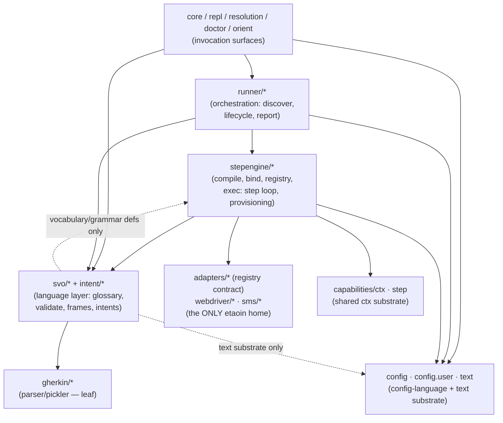

<!-- GENERATED — DO NOT EDIT. Derived from the internal source
     notes/architecture/module-map.md (development repo) by
     scripts/derive-arch-docs.bb. Edit the source, then re-run:
     bb scripts/derive-arch-docs.bb -->

# Module Map — checked against the actual require graph (2026-08-18; re-extracted 2026-08-26)

Arrows below are EXTRACTED from `(:require …)` forms across
`src/shiftlefter/**/*.clj` — **330 require edges** at the 2026-10-19
re-extraction (distinct `shiftlefter.*` → `shiftlefter.*` pairs, require
forms only; freshness-guarded by the test suite, which re-runs the
extraction and fails when this stamp disagrees with the code) — not drawn
from memory. Raw edge list: regenerate with the one-liner in § Method.
Re-stamped the same day (sl-afs9, +2 over the 314 the basis change
measured): `stepengine.exec` and `stepengine.exec.step-loop` now require
`shiftlefter.step` for the shared `error-classes` literal — the guard's
first live catch.
Re-stamped 2026-10-19 (sl-ectw, +5 over 325): the declared-shape
feature. `intent.loader → intent.shape` (the new shape analyzer, JDK-only
so the intent layer never reaches back into the engine);
`stepengine.bindings → intent.{loader,resolve}` (the matcher-slot
classifier resolves `Intent.element` refs to the element's `:shape` —
engine → language, the lawful direction, same as `stepengine.bind →
intent.state`); `stepengine.exec.step-loop → intent.state` (the exec
normalizer reads the same registry the lint read at plan time — the
shared-classifier doctrine, plan and run cannot disagree); and
`svo.bindings-lint → svo.extract` (placeholder → capture index, in-layer).
No new cycle: `intent.*` requires nothing under `stepengine` or `svo`.

## The intended shape (the laws as practiced)



Laws checked: (1) etaoin contained to the webdriver layer; (2) svo never
reaches up into stepengine/runner — EXCEPT engine-owned
vocabulary/grammar definitions; (3) gherkin is a leaf;
(4) stepengine never reaches up into runner — passes unrestated since
the config extraction (2026-08-26): the config-accessor exception
dissolved when `runner.config` moved to the neutral `shiftlefter.config`
address, so the one
formerly-excepted edge now points down into substrate. The dotted
SVO→CONFIG arrow is the language layer consuming ONLY the cluster's
`shiftlefter.text` did-you-mean substrate (`svo/{validate,bindings_lint}
→ text`); no svo namespace requires `shiftlefter.config` itself — the
`svo/validate → shiftlefter.config` row the earlier token grep produced
was a docstring mention, not a require, and the require-only edge list
does not carry it (the freshness guard pins that row as its live
anti-flap fixture).

## Verdict

**Sane.** No dependency cycles (the Clojure loader would refuse them), the
hub shape is as intended (invocation surfaces fan into runner; runner
orchestrates the engine; the engine consumes the language layer), gherkin
is a clean leaf (law 3 passes with zero violations).

## Method

The raw edge list, `source-ns -> target-ns`, from the repo root:

```bash
clojure -M -e "(require 'shiftlefter.arch-doc.freshness)
  (run! (fn [[a b]] (println a \"->\" b))
        (shiftlefter.arch-doc.freshness/require-edges \"src/shiftlefter\"))"
```

The extraction (`src/shiftlefter/arch_doc/freshness.clj`) reads each
file's `ns` form as data and walks its `(:require …)` specs (bare symbols,
`[lib :as x]` vectors, prefix lists), keeping `shiftlefter.*` targets — so
a docstring or comment that names a namespace is not an edge. The same
code runs inside the test suite (`shiftlefter.arch-doc.freshness-test`),
which compares the live edge count to the bold stamp in the header above
and fails naming the remedy: update the stamp (count and date), re-run
the extraction, regenerate this page. The earlier method — a
`grep -o "shiftlefter\.[a-z0-9.-]*"` over each file — counted qualified
names in prose and each file's own `ns` line too; its 525 rows
(2026-08-26) against 314 real edges (2026-08-30) is that noise, not a
relocation, and it is retired so a re-stamp cannot quote it again.

Cluster-level aggregate: `awk` the first path segment of each side, count
distinct arrows. Re-run after any relocation to verify the arrows moved.

## How this page stays true

This page is a mechanical projection of a live-maintained internal source,
regenerated — never hand-edited — by the derivation pipeline and
drift-guarded by the test suite: a hand edit here fails a test, and so
does a page that no longer matches its source.
