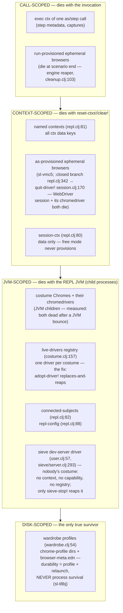

<!-- GENERATED — DO NOT EDIT. Derived from the internal source
     notes/architecture/repl-lifetimes.md (development repo) by
     scripts/derive-arch-docs.bb. Edit the source, then re-run:
     bb scripts/derive-arch-docs.bb -->

# REPL Custody & Lifetimes — who owns what, and how long it lives

Stamped against the code of the v0.5.5 release line (2026-08-18). This is
deliberately **not a flow map**: the REPL is the
only surface where things outlive the invocation, so the questions that
matter are *custody* (which verb owns this resource) and *lifetime*
(which layer it dies with).

**Why this map exists:** every REPL bug of an internal exercise cycle
just before v0.5.5 was a
misplacement on the ladder below. The chromedriver leak (sl-34fu) was a
JVM-scoped resource nobody owned; the durability overclaim (sl-t8bj) put
a JVM-scoped Chrome on the disk layer; the missing relaunch (sl-2de7)
was a state-machine edge nobody had drawn; the bare-browser gap and the
broken `:closed` branch (sl-vmc5) were a context-scoped resource that
could neither be created nor reaped. This is the diagram that would have
prevented all five. Placements below cite recorded measurements rather
than re-measuring.

## Where the REPL joins the engine

Both REPL entry points reach the same engine the CLI uses — the genuine
differences are exactly two, and both are lifetime facts:

- **`repl/as`** (`repl.clj:682`) executes a **single step with no plan
  and no hooks**: it calls `exec/invoke-step` directly (`repl.clj:655`)
  with a hand-built ctx. Since the bare-browser fix (sl-vmc5) it lazily provisions a bare
  browser for a subject with no costume, through the engine's own
  primitive: `ensure-step-capability` (`repl.clj:615`) →
  `exec/ensure-capability-for-svo` → `provisioning.clj:201`, yielding a
  `:mode :ephemeral` capability. Provisioning reads the effective
  config's `:interfaces` (`load-config!`, or the built-in defaults —
  sl-6wh9: the bare REPL mirrors `sl run` with no config file); with no
  entry for the step's interface nothing provisions and browser steps
  fail honestly with `:browser/no-session`. Custody
  rule (`repl.clj:663-672`): if provisioning succeeded and the step then
  failed, the ctx is **kept** — dropping it would strand a live browser
  where no cleanup verb could ever reach it.
- **`repl/run`** (`repl.clj:415`) parses and executes Gherkin
  **in-process** via `exec/execute-suite` (`repl.clj:476`), threading
  the config's `:interfaces` so provisioning and cleanup run exactly as
  in the runner.
- **`repl/step`** (`repl.clj:517`, free mode) has **no provisioning path
  at all** — by design, not omission: provisioning is SVO-keyed (a
  capability is a subject + interface), and free mode has no bound SVO,
  so there is nothing to provision against. Consequence:
  the unnamed `session-ctx` can never hold a browser, and `reset-ctx!`
  is a pure data reset with no cleanup obligation.
- The other genuine difference: **dynamic-var rebinding is the REPL's
  timing surface** — `binding` any of `*retry-timeout-ms*` /
  `*wait-timeout-ms*` / `*receive-timeout-ms*` / `*poll-interval-ms*`
  enters the `:timing` resolution ladder at the top `:override` rung
  (`step.clj:134`, sl-99u2).

### Two reapers, two lifetimes

The load-bearing distinction on this map: **`run`-provisioned and
`as`-provisioned ephemerals have different lifetimes because they have
different reapers.**

- A browser provisioned inside `repl/run` dies **at the end of its
  scenario** — the engine's own reaper (`cleanup-ephemeral-capabilities!`,
  `stepengine/exec/cleanup.clj:103`, driven from
  `execute-scenario-with-cleanup` `:152`) runs in-process exactly as it
  does under `sl run`. Contract pin: `repl_bare_browser_test.clj:84`.
- A browser provisioned by `repl/as` **outlives the call** — the `as`
  path never enters `execute-scenario-with-cleanup` (documented at
  `cleanup.clj:161-162`), so its ephemerals live in the named context
  until an explicit `reset-ctxs!`/`clear!`. Contract pin:
  `repl_bare_browser_test.clj:43`.

Collapsing these two into "the REPL cleans up browsers" is exactly the
class of confusion this map exists to kill.

## The lifetime ladder

Every resource sits on exactly one layer. Custody = the verbs that may
create or reap it.

Placement notes:

- **Run-provisioned ephemerals are call-scoped** in the sense that
  matters (they die with the scenario that made them), even though the
  same *kind* of resource is context-scoped when `as` makes it — the
  reaper, not the resource, decides the layer.
- **Costume Chromes are JVM-scoped, not disk-scoped.** The recorded
  measurement (deliberate JVM bounce, nothing closed by hand): both
  costume Chromes dead with the JVM; `list-costumes` honestly reported
  `:dead`; `connect-costume!` relaunched from the persisted profiles.
  The user-visible durability promise holds — its mechanism is the disk
  layer, not the process.
- **The chromedriver custody answer (sl-34fu):** each costume owns at
  most one live driver, held in the `live-drivers` registry
  (`costume.clj:157`). `adopt-driver!` (`:160`) replaces-and-reaps on
  every `connect-costume!` (`:384`, `:410`) and every auto-reconnect
  (`:223`, `:241`); `destroy-costume!` reaps and forgets (`:522/:528`).
  The measured leak (+1 chromedriver per connect, 11 live at peak) is
  closed by construction. `relaunch-costume!` spawns no driver and
  never touches the registry (`:447-449`).
- **The sieve dev server's driver** is the map's one deliberately odd
  citizen: a raw `eta/chrome` (`sieve/server.clj:293-300`) held by a
  top-level `def` in `dev/user.clj:57` that auto-starts at REPL boot
  (skip with `SIEVE=0`). It is in no named context, no capability, no
  registry — invisible to `reset-ctxs!`, `clear!`, and the costume
  verbs; `user/sieve-stop!` (`user.clj:71`) is its only reaper. It has
  confused three separate investigations; it is on the map so it never
  confuses a fourth. Live verification at the stamp (outside the recorded
  measurements' cover): in a fresh REPL, boot printed
  `[sieve] Failed to start: Address already in use` and `user/sieve-env`
  is nil — port 3333 was already held by **another** JVM,
  which is this placement demonstrated: a sieve driver is
  JVM-scoped to whoever launched it and invisible to everyone else's
  cleanup verbs.

## The daemon JVM — same ladder, different JVM (sl-s35y)

The warm daemon is a second long-lived JVM this map previously did not
place: everything JVM-scoped above is
**daemon-JVM-scoped** when the resource was made by a warm `sl run` —
in particular a worn costume's Chrome and its chromedriver (the same
`live-drivers` registry, one driver per costume, in the daemon's
process). The reaper-decides-the-layer law applied:

- **Reapers:** `sl daemon stop` and the 60-min idle kill (both end the
  JVM — costume Chromes are its children), plus the per-costume
  destroy/relaunch flows exactly as in the dev REPL.
- **NOT a reaper:** run end. A warm run's worn costume staying alive
  between invocations is costume **persistence working** — the same design as the dev REPL JVM, and why
  consecutive warm runs share authenticated browser state while cold
  runs never do.
- **Inspection verb:** `sl daemon status` lists the daemon's live
  costumes and driver liveness (`daemon/custody-status!` over
  `costume/custody-snapshot` — a pure read). Custody is visible, not
  inferred.
- The registry itself is in `daemon.clj`'s defonce inventory under
  DAEMON-SCOPED USER STATE, PERSISTENT BY DESIGN — deliberately never
  reset per dispatch.

## Overlay 1 — cleanup-verb reach

Which layers each verb may touch. The geometry is the cleanup contract
(sl-tss7; close-leak + mode-awareness landed as one interlocked change);
cited to its regression tests, not re-proven.

| Verb | Reaches | Never touches | Contract pins |
|---|---|---|---|
| `reset-ctx!` (repl.clj:106) | unnamed `session-ctx` data | any browser (none can exist there) | — |
| `reset-ctxs!` (repl.clj:113) / `clear!` (repl.clj:489) | context layer: `:closed` for ephemeral `:web` capabilities (real WebDriver quit + driver kill), then drops all named-ctx state; `clear!` also empties `connected-subjects` + registry | costumes (`:skipped-persistent` — mode-aware skip), the `live-drivers` registry, the wardrobe, the sieve driver | `repl_close_leak_test.clj:73` (`:closed` + exactly one quit), `:88` (real `eta/chrome` shape — the bare-browser regression), `:100` (zero quits on a costume because cleanup consults `:mode`), `:120` (exact `:skipped-persistent` action), `:136` (mixed ctxs, one quit); `repl_test.clj:301/:309` (`:none`, honest `:close-failed`) |
| `run` (engine reaper) | its own scenario's ephemerals, per scenario | anything `as` provisioned; costumes | `repl_bare_browser_test.clj:84` |
| `destroy-costume!` (costume.clj:589) | JVM + disk: kills Chrome by **port truth** (not recorded pid), reaps the owned driver, deletes the profile dir | other costumes' resources | `costume_test.clj:551` (reap+forget), `:569` (failed destroy keeps the handle) |
| `sieve-stop!` (user.clj:71) | the sieve server + its driver | everything else | code-read (dev tooling) |
| JVM death | everything JVM-scoped (child processes die with it) | the disk layer | the JVM-bounce measurement (sl-t8bj) |

The asymmetry is the lesson: **only `destroy-costume!` ever kills a
costume's Chrome** (`repl_close_leak_test.clj:16`), and nothing
short of JVM death reaps the sieve driver except its own verb.

## Overlay 2 — the costume state machine

Edges cite the verb's docstring or the change that introduced them.
`reset-ctxs!` is
deliberately **not an edge** — a context reset cannot move a costume
through this machine (`:skipped-persistent`); that absence is the
mode-awareness half of the cleanup contract.

```mermaid
stateDiagram-v2
    [*] --> Launched: init-costume! (costume.clj:277)<br/>launch-only, pristine profile,<br/>refuses existing
    Launched --> Launched: human logs in<br/>(credentials land in the profile)
    Launched --> Attached: connect-costume! (costume.clj:357)<br/>attach WebDriver + adopt-driver!<br/>replaces-and-reaps (sl-34fu)
    Attached --> Attached: drive via repl/as<br/>auto-reconnect on session error<br/>(browser.clj:92/110) — reconnect<br/>adopts-and-reaps (costume.clj:248/241)
    Attached --> Dead: JVM exit or Chrome death<br/>(Chrome is a JVM child — sl-t8bj)
    Dead --> Attached: connect-costume!<br/>relaunches from the profile
    Launched --> Relaunched: relaunch-costume! (costume.clj:452, sl-2de7)<br/>— launch-only reopen for<br/>human RE-login; idempotent when alive;<br/>spawns no driver
    Dead --> Relaunched: relaunch-costume!
    Relaunched --> Attached: connect-costume!
    Attached --> [*]: destroy-costume! (costume.clj:589)<br/>port-truth kill + reap + delete profile
    Launched --> [*]: destroy-costume!
    Dead --> [*]: destroy-costume!<br/>(profile deleted; the costume<br/>is gone from disk too)
```

The relaunch edge (sl-2de7) is the one the original machine lacked: once a costume
existed, launch-only (browser open, **no** session attached — what
re-authentication needs) was unreachable without dropping to internals.

## Siblings

- [The invocation map](invocation-map.md): every verb
  through the shared spine (the `repl` lane's `:repl` sentinel is where
  this map takes over).
- [module map](module-map.md).
- [the data-shape ledger](data-shapes.md): every boundary-crossing
  shape with producer/spec/consumers/stability; its ctx/capability rows
  are this map's custody column at rest.
- [the control loop](control-loop.md): the single-run time axis this
  map's state axis crosses — what one scenario provisions, this map's
  reapers own.

## How this page stays true

This page is a mechanical projection of a live-maintained internal source,
regenerated — never hand-edited — by the derivation pipeline and
drift-guarded by the test suite: a hand edit here fails a test, and so
does a page that no longer matches its source.
